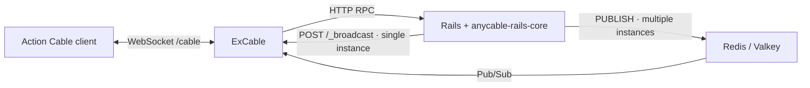
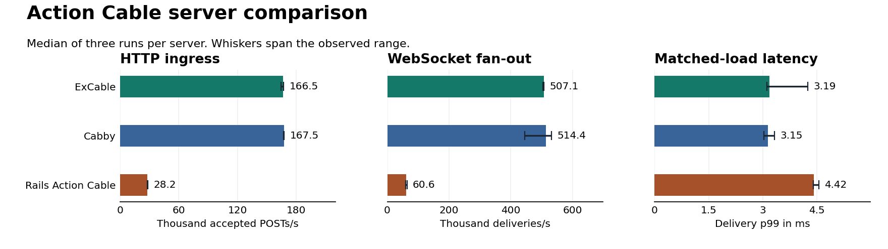

# ExCable

ExCable is a small Elixir server for Rails Action Cable WebSockets. It speaks
`actioncable-v1-json` and delegates authentication and channel callbacks to the Rails
application over AnyCable HTTP RPC. Existing `@rails/actioncable` clients and compatible Rails
channels use the same messages and identifiers.

Bandit runs one BEAM process per socket. Each process owns its connection and subscription state.
A socket sends up to four ready broadcast frames per write. A lone frame goes out immediately.
A partitioned OTP Registry routes broadcasts directly to local sockets. Redis Pub/Sub distributes
Rails broadcasts and remote disconnects across instances.



## Run with Rails

Add `gem "anycable-rails-core", require: "anycable/rails"` to the Rails Gemfile and install it
with Bundler. Set `adapter: any_cable` in `config/cable.yml` for the active Rails environment.
Export the same random `ANYCABLE_SECRET` in both terminals. Start Rails on the host with these
settings, then choose one of the two ways to run ExCable below.

```sh
export ANYCABLE_HTTP_RPC=true
export ANYCABLE_BROADCAST_ADAPTER=http
export ANYCABLE_HTTP_BROADCAST_URL=http://localhost:8080/_broadcast
export ANYCABLE_WEBSOCKET_URL=ws://localhost:8080/cable
bin/rails server
```

### Option 1 · Native Elixir

Use Elixir 1.19, Erlang/OTP 28 and `patch` for the pinned Bandit transport change.

```sh
rtk proxy mix deps.get
export EX_CABLE_RPC_URL=http://127.0.0.1:3000/_anycable
export EX_CABLE_PUBLIC_URL=http://localhost:8080/cable
export EX_CABLE_ALLOWED_ORIGINS=http://localhost:3000
rtk proxy mix run --no-halt
```

For a production release, build and start the release in the same environment.

```sh
rtk proxy env MIX_ENV=prod mix release
rtk proxy _build/prod/rel/ex_cable/bin/ex_cable start
```

### Option 2 · Docker

With Rails on the host, build the image and start it in Docker Desktop.

```sh
rtk proxy docker build -t ex-cable:local .
rtk proxy docker run --rm --name ex-cable -p 127.0.0.1:8080:8080 \
  -e ANYCABLE_SECRET \
  -e EX_CABLE_RPC_URL=http://host.docker.internal:3000/_anycable \
  -e EX_CABLE_PUBLIC_URL=ws://localhost:8080/cable \
  -e EX_CABLE_ALLOWED_ORIGINS=http://localhost:3000 \
  ex-cable:local
```

Allow the RPC hostname in Rails if host authorization is enabled. Check readiness with
`curl -fsS http://127.0.0.1:8080/healthz`. The Docker guide covers Linux Engine,
Rails on a shared container network and the image's Rails acceptance test. [Docker guide](docs/docker.md)

Point any explicit `createConsumer(url)` calls at `ws://localhost:8080/cable`. Keep the Rails
origin allowlist aligned with ExCable's. For the example above, Rails must allow
`http://localhost:3000` in `config.action_cable.allowed_request_origins`. In production, route
WebSocket upgrades through your TLS proxy and keep RPC endpoints and broker traffic private.
[Action Cable configuration](https://guides.rubyonrails.org/action_cable_overview.html#configuration) · [AnyCable HTTP RPC](https://docs.anycable.io/ruby/http_rpc)

### Run multiple instances

On Rails, install the `redis` gem and set `ANYCABLE_BROADCAST_ADAPTER=redis`. Set
`ANYCABLE_REDIS_URL` and the same `ANYCABLE_REDIS_CHANNEL` on Rails and every ExCable instance.
Route `/cable` through the load balancer. `GET /healthz` reports `503` while the configured
Redis subscription is unavailable. Redis Pub/Sub provides live delivery with no replay.
[Redis adapter configuration](https://docs.anycable.io/ruby/broadcast_adapters#redis-pub-sub)

### Configuration

| Environment variable | Default or behavior |
| --- | --- |
| `EX_CABLE_BIND` | `127.0.0.1`. Set an explicit interface for containers or remote proxies. |
| `PORT` | `8080` |
| `EX_CABLE_RPC_URL` | `http://127.0.0.1:3000/_anycable` |
| `ANYCABLE_SECRET` | Derives separate bearer keys for RPC and HTTP broadcasts. |
| `ANYCABLE_HTTP_RPC_SECRET` | Overrides the derived RPC key. |
| `ANYCABLE_BROADCAST_KEY` | Overrides the derived broadcast key. Without a key, `/_broadcast` is disabled. |
| `EX_CABLE_STATS_KEY` | Enables the statistics endpoint and authenticates the CLI. Set it on the server and in the CLI environment. |
| `EX_CABLE_PUBLIC_URL` | External cable URL. Without it, ExCable uses the upgrade's request URL. |
| `EX_CABLE_ALLOWED_ORIGINS` | Comma-separated exact browser origins. Defaults to the cable URL's HTTP origin. |
| `EX_CABLE_PROXY_HEADERS` | Comma-separated lowercase names. Defaults to `cookie,origin,authorization,x-request-id`. |
| `EX_CABLE_RPC_POOL_SIZE` | `16` HTTP connections per RPC origin. Set according to Rails capacity. |
| `EX_CABLE_RPC_TIMEOUT_MS` | `2000` per pool checkout, connect or request timeout. |
| `ANYCABLE_REDIS_URL` | Enables Redis Pub/Sub. Supports `redis://` or `rediss://`. |
| `ANYCABLE_REDIS_CHANNEL` | `__anycable__` |

A production release requires an RPC secret and either the public cable URL or an explicit
origin list. The Docker image listens on `0.0.0.0` inside the container.

## Statistics CLI

Set `EX_CABLE_STATS_KEY` before starting ExCable and use the same key in the terminal
that runs the CLI. The CLI defaults to `http://127.0.0.1:8080`. Use `--url BASE_URL`
for a different address or HTTPS when connecting across hosts.

```sh
rtk proxy mix cli                            # Print one snapshot from a running server
rtk proxy _build/prod/rel/ex_cable/bin/cli -f  # Refresh in place until Ctrl+C
ELIXIR_ERL_OPTIONS="+Bd" rtk proxy mix cli -f # Follow from a source checkout
```

The table shows active authenticated WebSockets, stream memberships, accepted broadcast
POSTs, stream publications from HTTP or Redis, slow consumers flagged for disconnect,
BEAM memory and processes, and Redis subscription status. Counters are per instance and
reset when ExCable starts. The first table shows rates since startup. Follow mode then
shows rates between successful samples, refreshing about once per second.

## Benchmark results

**Cabby led on median throughput. ExCable had the lowest delivery p99 under saturation.**
With 240 subscribers in one room, Cabby delivered **514,368 messages/s**, ExCable
**507,084/s** and Rails Action Cable **60,599/s**. Cabby's median was 1.4% above
ExCable's, and the faster gateway varied by trial. ExCable delivered **8.4×** the
Rails rate. At a matched 48,000 deliveries/s, Cabby and ExCable were within **0.042 ms**
of each other at p99.

| Server | HTTP POSTs/s, no subscribers | Accepted in 8 s | Saturated deliveries/s | Delivery p99 at 48k/s | Delivery p99 at saturation |
| --- | ---: | ---: | ---: | ---: | ---: |
| ExCable | 166,529 | 1,332,235 | 507,084 | 3.189 ms | **5.934 ms** |
| Cabby | **167,456** | **1,339,649** | **514,368** | **3.147 ms** | 17.100 ms |
| Rails Action Cable | 28,250 | 225,997 | 60,599 | 4.422 ms | 43.846 ms |

Medians of three serial trials per server and workload on one Apple M4 Max. HTTP ingress
used 128 publishers. Fan-out used eight publishers offering 200 or 8,000 POSTs/s.
Across all fan-out trials, clients received **36,315,360 of 36,315,360** eligible messages.
At saturation the publishers skipped send slots on all three servers.



[Workloads, trial ranges, p95/p99, RSS and raw data](docs/benchmarks/current/README.md)

**One-hour churn.** With four-frame writes, ExCable delivered all 5,080,100 eligible
messages and completed all 34,404 planned reconnects during the room-burst run.
Delivery p99 was 1.770 ms and gateway RSS over the final five minutes was 189.88 MiB.
[Churn report and charts](docs/benchmarks/batch4/churn/README.md)

## Testing

### Unit and integration tests

```sh
rtk proxy mix format --check-formatted
rtk proxy mix compile --warnings-as-errors
rtk proxy mix test
```

The default suite uses real WebSocket and HTTP sockets with a local RPC fixture. To include the
Rails and multi-instance broker checks, install the pinned fixture gems and point the test suite
at Ruby and Valkey executables.

```sh
rtk proxy gem install anycable-rails-core:1.6.2 actioncable:8.1.1 railties:8.1.1 puma:7.1.0
EX_CABLE_RAILS_RUBY=/absolute/path/to/ruby \
EX_CABLE_TEST_VALKEY=/absolute/path/to/valkey-server \
  rtk proxy mix test --cover
```

Run the [same Rails acceptance test against the Docker image](docs/docker.md#test-the-image)
to verify the packaged release.

### Performance and memory tests

The Go load driver exercises the standard Action Cable protocol over loopback. It verifies
every eligible delivery by sequence number and measures throughput, tail latency and reconnect
recovery. The benchmark runner can sample RSS and load the optional BEAM memory probe into a
production release. The probe records allocator blocks and carriers, occupied process heaps,
and a post-drain snapshot after a major garbage collection.

```sh
rtk proxy go -C bench test ./...
rtk proxy go -C bench build -o /tmp/excable-bench .
```

See the [current comparison commands](docs/benchmarks/current/README.md#reproduce),
[one-hour churn workloads](docs/benchmarks/batch4/churn/README.md) and
[BEAM allocator and live-heap measurements](docs/benchmarks/beam-memory.md).

[Architecture](docs/architecture.md) · [Protocols and compatibility](docs/protocol.md) ·
[Development plan](docs/plan.md) · [Tasks](docs/tasks.md) · [Benchmarks](docs/benchmarks/README.md)
