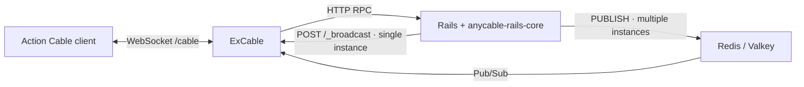

# ExCable

ExCable is a small Elixir server for Rails Action Cable WebSockets. It speaks
`actioncable-v1-json` and delegates authentication and channel callbacks to the Rails
application over AnyCable HTTP RPC. Existing `@rails/actioncable` clients and compatible Rails
channels use the same messages and identifiers.

Bandit runs one BEAM process per socket. Each process owns its connection and subscription state.
A partitioned OTP Registry routes broadcasts directly to local sockets. Redis Pub/Sub distributes
Rails broadcasts and remote disconnects across instances.



## Run with Rails

Use Elixir 1.19 and Erlang/OTP 28. Install the Elixir dependencies.

```sh
rtk proxy mix deps.get
```

Add `gem "anycable-rails-core", require: "anycable/rails"` to the Rails Gemfile and install it
with Bundler. Set `adapter: any_cable` in `config/cable.yml` for the active Rails environment.
Start Rails with these environment variables. Set `ANYCABLE_SECRET` to the same random value
for Rails and ExCable.

```sh
export ANYCABLE_HTTP_RPC=true
export ANYCABLE_BROADCAST_ADAPTER=http
export ANYCABLE_HTTP_BROADCAST_URL=http://localhost:8080/_broadcast
export ANYCABLE_WEBSOCKET_URL=ws://localhost:8080/cable
bin/rails server
```

Start ExCable in its own terminal.

```sh
export EX_CABLE_RPC_URL=http://127.0.0.1:3000/_anycable
export EX_CABLE_PUBLIC_URL=http://localhost:8080/cable
export EX_CABLE_ALLOWED_ORIGINS=http://localhost:3000
rtk proxy mix run --no-halt
```

Point any explicit `createConsumer(url)` calls at `ws://localhost:8080/cable`. Keep the Rails
origin allowlist aligned with ExCable's if your Rails app overrides it. In production, route
WebSocket upgrades through your TLS proxy and keep RPC endpoints and broker traffic private.
[Action Cable configuration](https://guides.rubyonrails.org/action_cable_overview.html#configuration) · [AnyCable HTTP RPC](https://docs.anycable.io/ruby/http_rpc)

### Run multiple instances

On Rails, install the `redis` gem and set `ANYCABLE_BROADCAST_ADAPTER=redis`. Set
`ANYCABLE_REDIS_URL` and the same `ANYCABLE_REDIS_CHANNEL` on Rails and every ExCable instance.
Route `/cable` through the load balancer. `GET /healthz` reports `503` while the configured
Redis subscription is unavailable. Redis Pub/Sub provides live delivery with no replay.
[Redis adapter configuration](https://docs.anycable.io/ruby/broadcast_adapters#redis-pub-sub)

### Configuration

| Environment variable | Default or behavior |
| --- | --- |
| `EX_CABLE_BIND` | `127.0.0.1`. Set an explicit interface for containers or remote proxies. |
| `PORT` | `8080` |
| `EX_CABLE_RPC_URL` | `http://127.0.0.1:3000/_anycable` |
| `ANYCABLE_SECRET` | Derives separate bearer keys for RPC and HTTP broadcasts. |
| `ANYCABLE_HTTP_RPC_SECRET` | Overrides the derived RPC key. |
| `ANYCABLE_BROADCAST_KEY` | Overrides the derived broadcast key. Without a key, `/_broadcast` is disabled. |
| `EX_CABLE_PUBLIC_URL` | External cable URL. Without it, ExCable uses the upgrade's request URL. |
| `EX_CABLE_ALLOWED_ORIGINS` | Comma-separated exact browser origins. Defaults to the cable URL's HTTP origin. |
| `EX_CABLE_PROXY_HEADERS` | Comma-separated lowercase names. Defaults to `cookie,origin,authorization,x-request-id`. |
| `EX_CABLE_RPC_POOL_SIZE` | `16` HTTP connections per RPC origin. Set according to Rails capacity. |
| `EX_CABLE_RPC_TIMEOUT_MS` | `2000` per pool checkout, connect or request timeout. |
| `ANYCABLE_REDIS_URL` | Enables Redis Pub/Sub. Supports `redis://` or `rediss://`. |
| `ANYCABLE_REDIS_CHANNEL` | `__anycable__` |

A production release requires an RPC secret and either the public cable URL or an explicit
origin list. Build and run it with those settings in the environment.

```sh
MIX_ENV=prod rtk proxy mix release
rtk proxy _build/prod/rel/ex_cable/bin/ex_cable start
```

## Testing

### Unit and integration tests

```sh
rtk proxy mix format --check-formatted
rtk proxy mix compile --warnings-as-errors
rtk proxy mix test
```

The default suite uses real WebSocket and HTTP sockets with a local RPC fixture. To include the
Rails and multi-instance broker checks, install the pinned fixture gems and point the test suite
at Ruby and Valkey executables.

```sh
rtk proxy gem install anycable-rails-core:1.6.2 actioncable:8.1.1 railties:8.1.1 puma:7.1.0
EX_CABLE_RAILS_RUBY=/absolute/path/to/ruby \
EX_CABLE_TEST_VALKEY=/absolute/path/to/valkey-server \
  rtk proxy mix test --cover
```

### Performance and memory tests

The Go load driver exercises the standard Action Cable protocol over loopback. It verifies
every eligible delivery by sequence number and measures throughput, tail latency and reconnect
recovery. The benchmark runner can sample RSS and load the optional BEAM memory probe into a
production release. The probe records allocator blocks and carriers, occupied process heaps,
and a post-drain snapshot after a major garbage collection.

```sh
rtk proxy go -C bench test ./...
rtk proxy go -C bench build -o /tmp/excable-bench .
```

See the [comparison and soak commands](docs/benchmarks/README.md#reproduce) and the
[BEAM memory investigation](docs/benchmarks/beam-memory.md) for the matching workload,
release profiles and raw data.

[Architecture](docs/architecture.md) · [Protocols and compatibility](docs/protocol.md) ·
[Development plan](docs/plan.md) · [Tasks](docs/tasks.md) · [Benchmarks](docs/benchmarks/README.md)
