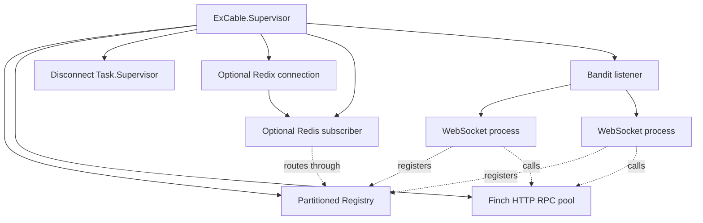

# Architecture

The socket owns its original request context, opaque Rails identifiers, serialized state and
stream memberships. A socket registers only the streams Rails authorizes. Each registration
carries a reference so that messages queued before an unsubscribe or stream change cannot
reach a later registration for the same subscription. Registry removes registrations when the
socket exits.

A broadcast validates its JSON once and shares the encoded payload with matching socket
processes. The socket combines the payload with the saved encoded subscription identifier.
Each socket permits up to 128 pending fan-out events. Overflow triggers a reconnect and stops
further enqueueing for that socket. Bandit applies a socket send timeout and caps both incoming
frame size and the size of reassembled fragmented messages. This bounds the cost of slow or
nonresponsive peers without putting other clients behind their writes.

Rails RPCs execute in connection order through a shared Finch pool. A command RPC failure
ends the session with a reconnect hint. Rails side effects may have committed before a transport
failure, so ExCable does not replay state-changing RPCs. Disconnect workers are supervised and
bounded by twice the RPC pool size. If all workers are busy, the closing socket gives the
disconnect RPC one attempt, subject to the same pool and request timeouts. A hard process or
node termination can interrupt callback delivery.

The supervisor starts the registry and RPC infrastructure before the listener. A registry
restart closes existing sockets so clients reconnect and rebuild memberships. Redix resubscribes
after network failures. The subscriber tracks acknowledgement for health checks. Redis carries
each publication to every subscribed node. HTTP broadcasts are local to the receiving node.
Live deliveries retain the order of one publication source, with no total order across
concurrent HTTP publishers.

## Source layout

| Path | Responsibility |
| --- | --- |
| `lib/ex_cable/application.ex` | OTP supervision and listener startup |
| `lib/ex_cable/config.ex` | Environment configuration and shared key derivation |
| `lib/ex_cable/http.ex` | WebSocket upgrade, origin checks, health and authenticated broadcast ingress |
| `lib/ex_cable/socket.ex` | Action Cable frames, lifecycle and session state |
| `lib/ex_cable/rpc.ex` | AnyCable HTTP requests and disconnect callbacks |
| `lib/ex_cable/broadcast.ex` | Broadcast validation, registry memberships and fan-out |
| `lib/ex_cable/redis.ex` | Optional Redis subscription and readiness |
| `test/` | Unit tests, socket tests and optional Rails and Valkey integration tests |

[Bandit](https://hexdocs.pm/bandit/Bandit.html) · [WebSock lifecycle](https://hexdocs.pm/websock/WebSock.html) · [OTP Registry](https://hexdocs.pm/elixir/1.19.5/Registry.html) · [Finch](https://hexdocs.pm/finch/Finch.html) · [Redix Pub/Sub](https://hexdocs.pm/redix/Redix.PubSub.html)
