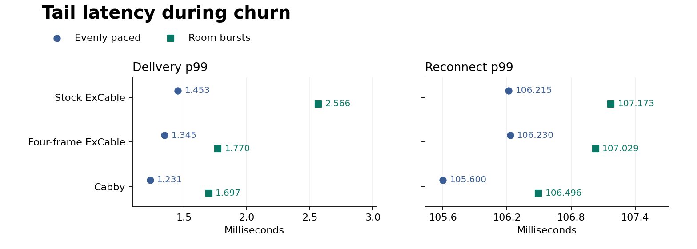
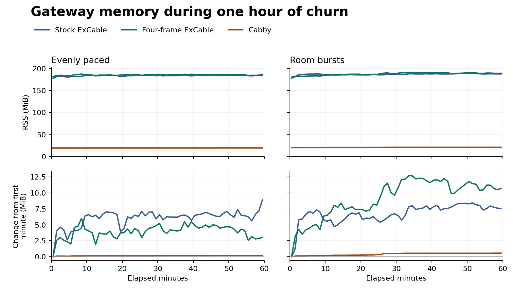

# One-hour WebSocket churn comparison

**Four-frame batching passed both one-hour workloads.** All six runs accepted every scheduled POST and delivered all **30,480,987 eligible messages**. Every one of the **206,424 planned reconnects** completed. There were zero unexpected disconnects, failed connection attempts, duplicates or misrouted frames.

| Workload | Gateway | Deliveries/s | Delivery p99 | Reconnect p99 | Missing / eligible | Completed / planned reconnects |
| --- | --- | ---: | ---: | ---: | ---: | ---: |
| Even | Stock ExCable | 1,411.17 | 1.453 ms | 106.215 ms | 0 / 5,080,206 | 34,404 / 34,404 |
| Even | Four-frame ExCable | 1,411.18 | 1.345 ms | 106.230 ms | 0 / 5,080,252 | 34,404 / 34,404 |
| Even | Cabby | 1,411.18 | 1.231 ms | 105.600 ms | 0 / 5,080,259 | 34,404 / 34,404 |
| Bursts | Stock ExCable | 1,411.13 | 2.566 ms | 107.173 ms | 0 / 5,080,085 | 34,404 / 34,404 |
| Bursts | Four-frame ExCable | 1,411.14 | 1.770 ms | 107.029 ms | 0 / 5,080,100 | 34,404 / 34,404 |
| Bursts | Cabby | 1,411.13 | 1.697 ms | 106.496 ms | 0 / 5,080,085 | 34,404 / 34,404 |



| Workload | Gateway | First minute | Last minute | Last five minutes | Peak | After settling |
| --- | --- | ---: | ---: | ---: | ---: | ---: |
| Even | Stock ExCable | 178.28 MiB | 187.20 MiB | 184.94 MiB | 187.53 MiB | 183.77 MiB |
| Even | Four-frame ExCable | 181.95 MiB | 184.98 MiB | 184.82 MiB | 188.47 MiB | 185.38 MiB |
| Even | Cabby | 19.34 MiB | 19.55 MiB | 19.55 MiB | 19.55 MiB | 18.28 MiB |
| Bursts | Stock ExCable | 180.86 MiB | 188.45 MiB | 188.51 MiB | 190.56 MiB | 185.20 MiB |
| Bursts | Four-frame ExCable | 178.95 MiB | 189.68 MiB | 189.88 MiB | 192.17 MiB | 187.23 MiB |
| Bursts | Cabby | 20.34 MiB | 20.91 MiB | 20.91 MiB | 20.91 MiB | 19.36 MiB |



**Default decision.** During bursts, batching reduced stock ExCable's delivery p99 by **31.0%** and added **1.37 MiB** to its last-five-minute RSS. With even pacing, delivery p99 fell **7.4%** and late RSS differed by **−0.12 MiB**. Batched RSS rose early in the burst run. On both schedules, its final five-minute median was **1.30 MiB lower** than during minutes 30–35. Cabby had the smallest gateway RSS and the lowest p99 on both schedules. Together with the [33.4% saturation throughput gain](../README.md), these results supported enabling batching by default.

## Workload

On November 24, 2026, stock ExCable (`b31bb1b`), the four-frame build of that revision, and Cabby (`7b97ba1`) each ran two 60-minute workloads on one Apple M4 Max with 16 cores and 64 GiB of memory. Each instance had its own Rails HTTP RPC fixture and Go driver on loopback. Both ExCable releases used the same VM settings. [Host and software versions](../../README.md#environment)

Each driver kept 240 clients distributed over 12 rooms. Clients closed their TCP connections after seeded 15–35 second lifetimes and waited 100 ms before reconnecting and resubscribing. Each trial had four seconds of idle time, a minute of publishing warmup, an hour of measurement, ten seconds of drain and 30 seconds of RSS settling.

- **Evenly paced.** One publisher scheduled 72 POSTs/s, rotating through the 12 rooms. Each room received six publications/s.
- **Room bursts.** Four publishers scheduled four independent POSTs to the same room at once, then moved to the next room. The aggregate rate stayed at 72 POSTs/s. Each POST carried its own sequence number and timestamp.

The six instances shared the machine. The burst group started about four minutes after the evenly paced group. This gives each variant in a group comparable host conditions. The result describes a single hour per server and schedule at this load. A separate short instrumented process checked transport writes during the first part of the run. [Earlier serial saturation trials](../README.md)

All three servers in each group used the same driver binary. The evenly paced group used the existing capacity driver. The burst group used the new scheduler, which preserves the original deadlines and sequence order when the burst size is one. [Scheduler tests](../../../../bench/publish_test.go)

## Interpreting the measurements

Delivery p99 measures elapsed time from starting the HTTP POST to decoding the WebSocket message, including eligible frames received during drain. The load generator counts one eligible delivery per accepted publication and confirmed room member. It excludes the first and last 200 ms of each subscription interval to handle ambiguity around connection changes. Reconnect p99 includes the client's fixed 100 ms delay and ends at subscription confirmation.

RSS is the operating system's resident memory for the gateway process, sampled about every five seconds. First and last refer to medians of the first and last measured minutes. Peak is the largest measured sample. Residual is a sample after clients leave and the settling period ends. The summary also includes the last-minute RSS of the gateway and Rails RPC process combined. Each plotted point is a one-minute median.

For the default decision, we compared the four-frame build with stock on each schedule. We required every eligible delivery and planned reconnect, with zero duplicate or misrouted deliveries and zero unexpected disconnects. We used margins of +10 MiB for the final five-minute median RSS, +1 ms for delivery p99 and +5 ms for reconnect p99. We also compared the final five minutes of RSS with minutes 30–35 for late growth. These margins apply to this experiment.

## Batching during churn

A separate four-frame release ran the same burst schedule with the transport probe enabled. Across warmup, 45 measured seconds and drain, 1,171 connection lifetimes emitted **150,578 broadcast frames in 56,383 writes**, or **2.67 frames/write**. That saved **62.6%** of writes against one send per frame. The measured interval delivered all 63,562 eligible messages and completed all 420 planned reconnects. The six hour-long subjects ran with the probe disabled. [Write histogram and driver counts](write-probe.json)

The production release built from the default checkout matched the soak candidate's executable BEAM checksums for the socket, broadcaster and Bandit WebSocket connection. The enabled build passed all 31 ExUnit tests with Rails and Valkey, including ordered writes, stale subscriptions, a queued remote disconnect and a stalled consumer.

## Reproduce

Build the burst-capable driver from this checkout. The benchmark snapshot at `7c3abd8` builds stock ExCable from its root and the exact four-frame candidate through its `bench/batch4/prepare.sh`. Use separate release directories and set `STOCK_BIN`, `BATCH4_BIN`, `CABBY_BIN` and `BENCH_RUBY` to absolute executable paths. Set `RESULTS` to a new directory. [Release build commands](../README.md#reproduce) · [Fixture setup](../../README.md#reproduce)

```sh
rtk proxy go -C bench test .
rtk proxy go -C bench build -o /tmp/excable-churn-driver .
```

Run the following block with `MODE=even` and `BURST=1` in one terminal. Start it in another terminal four minutes later with `MODE=bursts` and `BURST=4`.

```sh
for variant in stock batch4 cabby; do
  case "$variant" in
    stock) server=excable; binary=$STOCK_BIN ;;
    batch4) server=excable; binary=$BATCH4_BIN ;;
    cabby) server=cabby; binary=$CABBY_BIN ;;
  esac
  rtk proxy python3 bench/run.py soak --servers "$server" "--$server" "$binary" \
    --driver /tmp/excable-churn-driver --ruby "$BENCH_RUBY" --soak-duration 60m \
    --burst "$BURST" --out "$RESULTS/$MODE/$variant" &
done
wait
```

The [raw driver summaries and RSS samples](raw/) are organized by schedule and server. To regenerate the [summary](summary.csv) and both figures with Python and Matplotlib, run the following command.

```sh
rtk proxy python3 bench/batch4/plot_churn.py docs/benchmarks/batch4/churn
```
