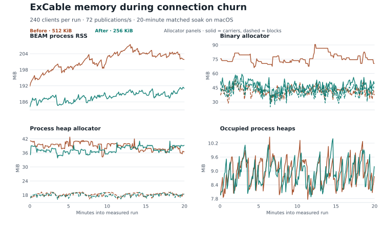

# BEAM memory under connection churn

## Matched 20-minute soak

On the Apple M4 Max test host, changing the Darwin release's binary allocator threshold from
512 to 256 KiB reduced last-minute ExCable RSS by 11.48 MiB and peak measured RSS by
16.03 MiB. RSS still rose 4.41 MiB over the run, down from
7.75 MiB. The last-minute medians show about 40–41 MiB of allocated binary blocks in either
profile. Carrier capacity fell by 27.85 MiB as large buffers moved to
single-block carriers. The matched result ties the RSS reduction to the binary allocator layout. Process heaps
and registry counts were comparable.



| Memory metric (MiB) | Before, first / last / peak | After, first / last / peak |
| --- | ---: | ---: |
| ExCable process RSS | 194.55 / 202.30 / 207.45 | 186.41 / 190.82 / 191.42 |
| Combined ExCable and Rails RPC RSS | 271.37 / 280.58 / 285.34 | 263.48 / 268.98 / 269.64 |
| Binary allocator blocks | 40.56 / 40.05 / 54.31 | 40.69 / 41.38 / 53.33 |
| Binary allocator carriers | 73.53 / 74.53 / 90.53 | 46.97 / 46.68 / 59.23 |
| Binary single-block carriers | 0.00 / 0.00 / 0.00 | 39.06 / 39.65 / 51.95 |
| Process heap allocator blocks | 17.47 / 17.92 / 19.40 | 17.98 / 18.12 / 19.19 |
| Process heap allocator carriers | 40.76 / 36.63 / 42.77 | 38.77 / 39.02 / 41.02 |
| Occupied process heaps | 8.33 / 8.58 / 10.46 | 8.34 / 8.82 / 10.39 |
| BEAM process memory used | 30.19 / 30.64 / 32.31 | 30.80 / 30.86 / 31.97 |

First and last are medians of samples in the first and last minutes of the measured window.
Peak is the maximum sampled in that window. Combined RSS includes the independent Rails RPC
process. The median number of live registry entries was 478 at both ends of both runs.

| Delivery metric | Before | After |
| --- | ---: | ---: |
| Delivered messages/s | 1,411.16 | 1,411.16 |
| Missing / eligible deliveries | 0 / 1,693,390 | 0 / 1,693,392 |
| Delivery p95 / p99 (ms) | 1.91 / 3.08 | 1.91 / 3.13 |
| Completed planned reconnects / unexpected disconnects | 11,449 / 0 | 11,449 / 0 |
| Reconnect p95 / p99 (ms) | 107.44 / 109.33 | 107.45 / 109.27 |

Each run accepted all 86,400 publications and reported zero duplicates, misroutes, failed
connection attempts or incomplete reconnects.

| After drain | Baseline, pre-GC / post-GC | Tuned, pre-GC / post-GC |
| --- | ---: | ---: |
| ExCable process RSS (MiB) | 199.48 / 192.45 | 190.17 / 180.72 |
| Occupied process heaps (MiB) | 5.75 / 0.63 | 5.08 / 0.63 |
| Binary allocator blocks (MiB) | 14.20 / 14.13 | 14.17 / 14.10 |
| Binary allocator carriers (MiB) | 58.53 / 58.53 | 20.70 / 20.70 |
| Registry entries | 0 / 0 | 0 / 0 |

Major GC released occupied process heap memory in both profiles. The driver-managed binary
blocks persisted across the collection. The tuned profile held those blocks in fewer
carrier bytes. This comparison uses one matched run per profile on macOS. Its measurements
cover 20 minutes of churn.

[Baseline samples](memory-comparison/before/soak/072-1-excable/) ·
[Tuned samples](memory-comparison/after/soak/072-1-excable/)

## Initial reproduction

On November 24, 2026, an instrumented 20-minute run reproduced the increase. The ExCable
process RSS rose from 188.55 to 208.75 MiB between the first and last minute medians.
Occupied process heaps stayed at 6.93 and 6.92 MiB. Binary allocator block bytes increased
from 34.53 to 41.79 MiB, and its carriers represented about 70 MiB throughout. Process heap
allocator blocks changed from 15.67 to 15.84 MiB, while their carrier capacity grew from
33.27 to 36.87 MiB.

After the driver left, the registry held zero entries. A major GC dropped occupied process
heaps from 4.55 to 0.67 MiB and process heap carriers from 39.41 to 17.22 MiB. Binary
blocks remained near 14 MiB. RSS moved from 202.48 to 197.86 MiB. The tracked application
state was released while the VM and TCP driver retained memory.
[Initial run samples](memory-before/soak/072-1-excable/)

## Source of binary allocation pressure

The tagged diagnostic identified `tcp_inet` driver binaries in the 256–512 KiB size bin.
The legacy inbound Bandit sockets used a 9,216-byte driver buffer. The outbound Rails RPC
sockets used 408,300 bytes for a user-space buffer on this host. Mint sizes that buffer using
the largest of the socket's send, receive and driver buffers. Short RPC replies still use
that allocation on the read path. The OTP inet driver caches reusable buffers per driver
thread. Those allocations can survive a major process GC.
[Mint buffer selection](https://github.com/elixir-mint/mint/blob/v1.11.0/lib/mint/core/util.ex#L51) ·
[OTP inet driver buffer management](https://github.com/erlang/otp/blob/OTP-28.5/erts/emulator/drivers/common/inet_drv.c#L2027)

Requesting 64 KiB socket buffers still produced a 342,972-byte driver buffer on macOS and
left driver allocations in the same size bin. The socket NIF removed the large legacy
driver allocations in an exploratory run and added a process per TCP connection. The
production change keeps the transport and applies `+MBsbct 256` to Darwin releases built
by Mix. The setting allocates binaries above 256 KiB in individual carriers. With the
default 512 KiB threshold, the 408,300-byte driver blocks shared multi-block carriers.
[OTP 28 allocator options](https://www.erlang.org/docs/28/apps/erts/erts_alloc.html) ·
[Tagged diagnostic samples](memory-probes/)

## Measurement

The two comparison runs use one ExCable release, one probe build, the same 16 schedulers,
the same host and the same fixture and driver as the [original comparison](README.md).
Each runs with 240 WebSockets across 12 rooms, 72 publications/s, the same 15–35 second
churn schedule and seed, a 60-second warmup, a 20-minute measurement window, and a
10-second drain. The matching baseline and tuned release run concurrently on the host.
The initial diagnostic baseline ran before the pair and briefly shared the host with the
exploratory probes.

The benchmark writes RSS and BEAM samples approximately every five seconds.
`processes_used` is the VM's process memory accounting. Occupied heap words come from
young- and old-generation heap occupancy, summed across running processes. These can
include unreachable terms pending GC. The probe takes another occupied-heap snapshot
after a major GC across remaining processes, after the load and 30-second settling
period. Forced GC takes place outside the measured workload.

Allocator block bytes count allocated blocks, including allocator overhead. Carrier bytes
sum single-block, multiblock and abandoned pool carriers. Carrier capacity and OS resident
pages are different quantities. The sampler also records registry size, mailbox counts,
blocks and carriers by allocator instance, and mseg cache counts. The separate tagged probes use
the OTP `instrument` module. [OTP memory instrumentation](https://www.erlang.org/docs/28/apps/runtime_tools/instrument.html)

## Reproduce

Build the Go driver, production release and probe from the repository root. Use Ruby with
the fixture gems installed. See the [benchmark setup](README.md#reproduce).

```sh
rtk proxy go -C bench build -o /tmp/excable-bench .
rtk proxy env MIX_ENV=prod mix release
rtk proxy mkdir -p /tmp/excable-beam-probe
rtk proxy elixirc -o /tmp/excable-beam-probe bench/beam_memory.ex
```

Start the following two commands in separate terminals. Set `BENCH_RUBY` to the same Ruby
executable in both. The 512 KiB override recreates the baseline on Darwin. The probe records
the effective threshold in `beam-settings.json`.

```sh
rtk proxy env ERL_FLAGS='+MBsbct 512' python3 bench/run.py soak --servers excable \
  --driver /tmp/excable-bench --ruby "$BENCH_RUBY" \
  --beam-probe /tmp/excable-beam-probe --out /tmp/excable-memory-before
```

```sh
rtk proxy python3 bench/run.py soak --servers excable \
  --driver /tmp/excable-bench --ruby "$BENCH_RUBY" \
  --beam-probe /tmp/excable-beam-probe --out /tmp/excable-memory-after
```

For the separate diagnostic, set `BENCH_INSTRUMENT` to the installed OTP path of
`instrument.beam` without the `.beam` extension and replace `soak` with `smoke`.
