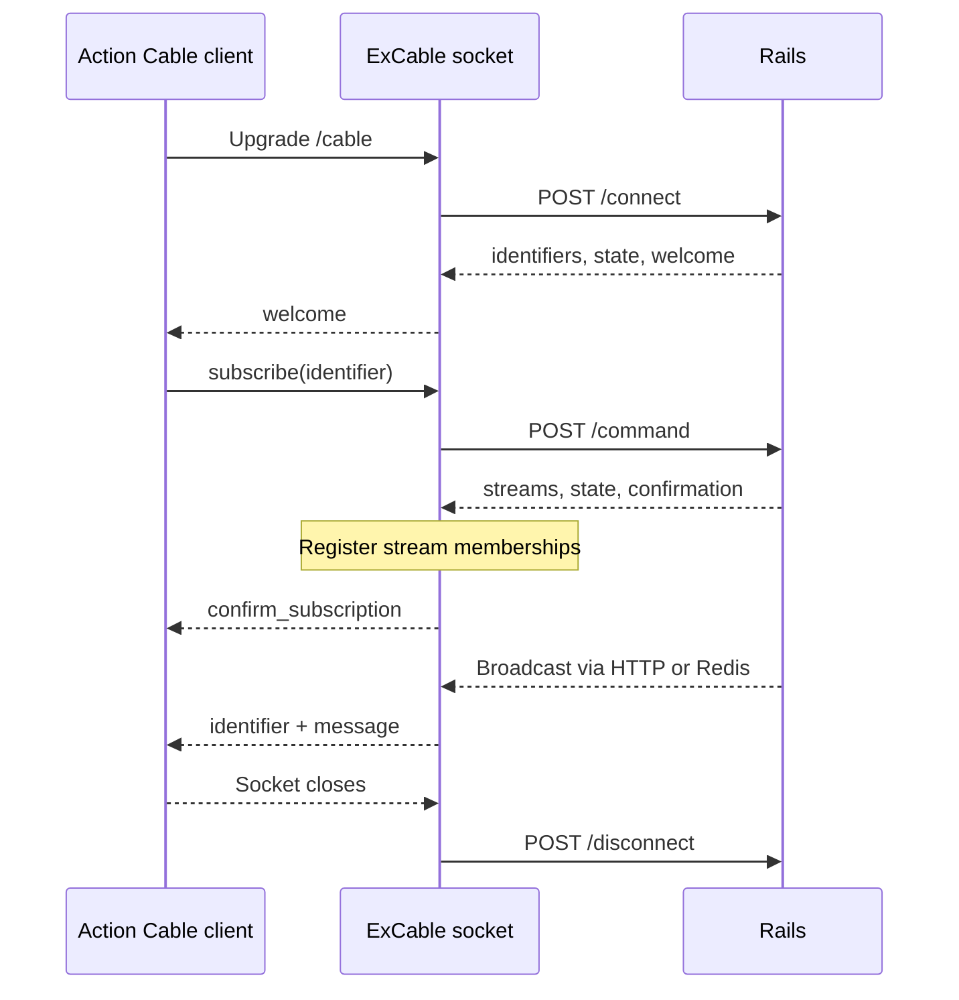

# Protocols and compatibility

## Client WebSocket

`GET /cable` negotiates `actioncable-v1-json` when offered. Native clients may omit the
subprotocol header. ExCable checks the browser's `Origin` before upgrading, then asks Rails to
authorize the connection using its request URL and configured headers.

| Direction | Message | Behavior |
| --- | --- | --- |
| Server to client | `welcome` or `disconnect` | Accepts the connection or closes with a reason and a reconnect flag. |
| Server to client | `ping` | Unix time in seconds, every three seconds after an initial stagger. WebSocket ping/pong checks liveness. |
| Client to server | `subscribe` | Sends the opaque `identifier` to Rails and responds with confirmation or rejection. |
| Client to server | `message` | Passes the original JSON-encoded `data` string to Rails for an active subscription. |
| Client to server | `unsubscribe` | Runs the Rails callback and removes local memberships. There is no acknowledgement frame. |
| Server to client | `identifier` + `message` | A direct Rails transmission or a broadcast for that subscription. |

Subscription identifiers are JSON strings and return to the client byte-for-byte. The gateway
also accepts a repeated subscription request for an active identifier and confirms it without
running `subscribed` again. Frame and publication limits are 64 KiB. Each socket permits up to
256 subscriptions, with an identifier limit of 8 KiB.
[Action Cable protocol](https://docs.anycable.io/misc/action_cable_protocol)

## Rails HTTP RPC

RPC uses JSON POST requests under `EX_CABLE_RPC_URL`, carrying
`X-Anycable-Meta-Sid`, `X-Anycable-Meta-Protov: v1`, and, when configured,
`Authorization: Bearer <key>`.

| Endpoint | Request | Reply |
| --- | --- | --- |
| `/connect` | `env` with external WebSocket URL and request headers | `identifiers`, `transmissions`, environment patch |
| `/command` | `command`, `identifier`, `connection_identifiers`, optional `data`, and `env` | `streams`, `stopped_streams`, `stop_streams`, `transmissions`, environment patch and `disconnect` |
| `/disconnect` | `identifiers`, active `subscriptions`, and connection `env` | `status` |

Numeric status codes are `0` for error, `1` for success and `2` for application rejection.
Rails sends transmissions as JSON strings. Connection state (`cstate`) and subscription state
(`istate`) are string-to-string maps. Patches set values and delete keys whose value is the
empty string. Instance state is sent with commands for its subscription.
[HTTP RPC](https://docs.anycable.io/ruby/http_rpc) · [AnyCable protobuf definitions](https://docs.anycable.io/misc/rpc_proto)



## Broadcast publication

The HTTP endpoint is `POST /_broadcast`. It requires `Authorization: Bearer <broadcast key>`
and returns `201` when the publication is accepted. Invalid publications return `422`.
The Redis path reads the same publication from `ANYCABLE_REDIS_CHANNEL`.

A publication is a stream envelope or a nonempty array of stream envelopes. The `data` field
contains a complete, encoded JSON value. Optional `meta.exclude_socket` carries the socket ID to
skip. A remote disconnect uses the Rails connection identifiers exactly as returned by RPC.

```json
{"stream":"room:42","data":"{\"text\":\"hello\"}"}
```

```json
{"command":"disconnect","payload":{"identifier":"{\"account\":\"42\"}","reconnect":false}}
```

## Cabby reference and scope

The Cabby reference uses upstream AnyCable-Go 1.6.21, pinned in its
[compatibility lock](../examples/cabby/compat/upstream.lock). Cabby combines the standard Rails
WebSocket protocol with AnyCable server features. ExCable
implements the standard protocol, HTTP RPC, HTTP broadcasts and Redis Pub/Sub. The Cabby
reference includes separate extended protocols, session recovery, presence, NATS, gRPC, SSE,
Pusher and durable streams. Those features are outside this release.

The Rails side has the compatibility limits of the AnyCable Rails adapter. Use
`state_attr_accessor` for persisted Ruby channel state. Applications that depend on arbitrary
in-memory Ruby channel state, periodic channel timers or custom `stream_from` callbacks need
migration work before moving those channels. Standard Action Cable reconnects establish a new
session and resubscribe. Broadcasts missed during a disconnect are not replayed.
[Cabby reference](../examples/cabby/README.md) · [AnyCable Rails compatibility](https://docs.anycable.io/rails/compatibility)
